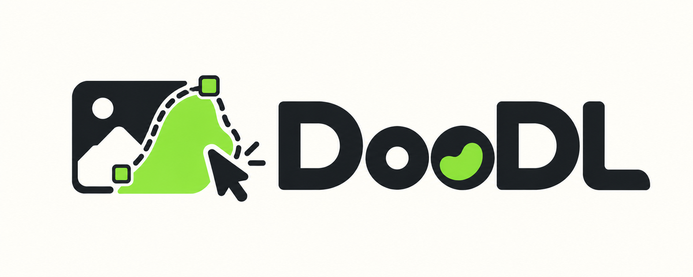
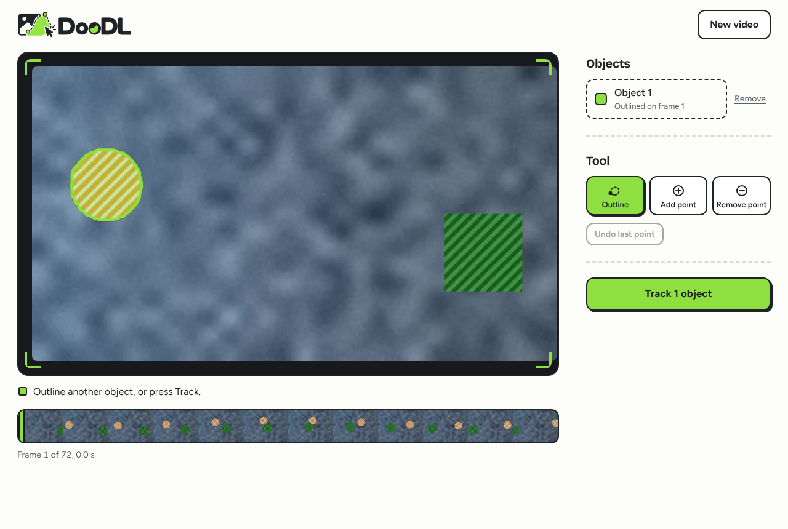
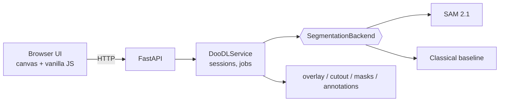

<p align="center"></p>

<p align="center">
  <a href="https://colab.research.google.com/github/Ahmed-ssam/DooDL-DrawToTrack/blob/main/notebooks/DooDL_Colab.ipynb"></a>
</p>

Interactive video object segmentation. Upload a clip, pick a frame, draw a rough outline around each object, and DooDL returns a video where every object is precisely segmented through the whole clip, each in its own color.

Built on [SAM 2.1](https://github.com/facebookresearch/sam2) (Meta, Apache-2.0). Runs on a free Colab T4 or any CUDA GPU. A CPU-only baseline ships too, so the UI, API and tests work anywhere.



> **Status.** Tested on a free Colab T4 with SAM 2.1 tiny: 296 frames tracked in about 2 minutes, peak GPU memory 0.76 GB.

## Features

- Draw a loose outline, or add positive/negative clicks to refine; the outline snaps to the object as you draw.
- Several objects at once, each with its own color. Prompt each on any frame; tracking runs forward and backward from it.
- Fix a bad frame: jump back, add clicks, re-track.
- Exports: `overlay.mp4`, `cutout.mp4` (objects on black), `masks.zip` (per-frame label PNGs) and `annotations.json` (COCO-style RLE).
- Safe defaults: upload size, duration, frame count and object limits; optional access token; sessions expire.
- Model-agnostic backend interface, so SAM 3.1 or another model can be added later.

## Try it

**1. In your browser, no install (best).** Click **Open in Colab** above, then **Runtime → Change runtime type → T4 GPU**, then **Runtime → Run all**. After about 3 minutes the app appears under the cell. Click **Try a sample** to see it work, or upload your own clip. Needs a Google account; runs SAM 2.1 on Google's free GPU.

**2. On your computer, one click.** Needs [Python 3.10 or newer](https://www.python.org/downloads/) (on Windows, tick "Add python.exe to PATH"). Download the repository as a ZIP (green **Code** button, then **Download ZIP**), unzip it, then:

- Windows: double-click `start.bat`
- macOS / Linux: run `./start.sh`

The first run sets itself up (a minute or two), then opens DooDL in your browser. Without an NVIDIA GPU it uses the basic CPU tracker, which is enough to try the interface but less accurate than SAM 2.1.

**3. From the command line.**

```bash
git clone https://github.com/Ahmed-ssam/DooDL-DrawToTrack.git && cd DooDL-DrawToTrack
pip install -e .
doodl serve --open            # http://127.0.0.1:8000
doodl check                   # what this machine can run
```

**SAM 2.1 on your own NVIDIA GPU**

```bash
pip install torch torchvision          # CUDA build for your system
pip install git+https://github.com/facebookresearch/sam2.git
doodl serve --open --backend sam2 --model tiny
```

Weights download on first use.

Something wrong? Run `doodl check` and open an issue with its output.

## How it works



1. The upload is probed and decoded to JPEG frames, capped by fps, duration and size.
2. An outline becomes model prompts (default `box_points`: box plus well-spread positive points and ring of negatives).
3. One forward pass tracks all objects, plus one reverse pass per distinct start frame.
4. Masks are stored per frame as indexed PNGs, then rendered and exported.

More in [docs/architecture.md](docs/architecture.md).

## Configuration

Environment variables (or CLI flags on `doodl serve`):

| Variable | Default | Meaning |
|---|---|---|
| `DOODL_BACKEND` | `auto` | `auto`, `sam2` or `classical` |
| `DOODL_SAM2_MODEL` | `tiny` | `tiny`, `small`, `base_plus`, `large` |
| `DOODL_PRECISION` | `auto` | bf16 on Ampere or newer, otherwise fp32 |
| `DOODL_PROMPT_STRATEGY` | `box_points` | `box_points`, `mask`, `grabcut` |
| `DOODL_MAX_UPLOAD_MB` | 200 | upload cap |
| `DOODL_MAX_DURATION_S` / `DOODL_MAX_FRAMES` | 30 / 450 | longer clips are trimmed |
| `DOODL_MAX_OBJECTS` | 8 | objects per video |
| `DOODL_ACCESS_TOKEN` | none | require `X-DooDL-Token` or `?token=` |
| `DOODL_SESSION_TTL_MIN` | 60 | idle sessions are deleted |

## API

| Method and path | Purpose |
|---|---|
| `GET /api/health` | backend, limits |
| `POST /api/sessions?filename=` | upload a video (raw body) |
| `POST /api/samples/synthetic` | create a session from the sample clip |
| `GET /api/sessions/{id}/frames/{i}` | a frame (`?w=` thumbnail) |
| `POST /api/sessions/{id}/objects` | add an object from an outline |
| `POST /api/sessions/{id}/objects/{oid}/clicks` | refine with clicks |
| `POST /api/sessions/{id}/track` | start tracking, returns a job |
| `GET /api/jobs/{id}`, `POST /api/jobs/{id}/cancel` | poll or cancel |
| `GET /api/sessions/{id}/downloads/{name}` | results |

## Evaluation

Quality is measured with **J** (how much the predicted mask overlaps the true one), **F** (how close the predicted outline is to the true outline) and their mean **J&F**, the standard score in video object segmentation benchmarks (DAVIS). Scores need ground truth, so they come from a synthetic clip where the true masks are known exactly: a ball and a square that cross each other (with occlusion) over a moving background. Speed and memory are measured on a real clip.

| Backend | Device | Clip | Frames | Speed (FPS) | Peak GPU memory | J&F |
|---|---|---|---|---|---|---|
| Classical baseline (GrabCut + optical flow) | CPU | synthetic, 640x360 | 72 | 5.1 | n/a | 0.846 |
| SAM 2.1 tiny | Colab T4 | real portrait clip | 296 | 2.5 | 0.76 GB | n/a (no ground truth) |

SAM 2.1 runs in fp32 on a T4 (bf16 needs an Ampere or newer GPU), so speed is higher on newer cards. Reproduce the synthetic-clip numbers with `python scripts/benchmark.py --backend sam2 --model tiny --markdown`. Protocol details: [docs/evaluation.md](docs/evaluation.md).

## Limitations

- SAM 2 keeps all frames in memory, so clips are capped (450 frames, 30 s by default). Long videos need chunking, which is not implemented.
- Fast, heavy occlusion or look-alike objects can swap or lose tracks; fix the frame and re-track.
- Text prompts are not supported (SAM 3.1 would add them).
- The synthetic benchmark is a sanity check, not a substitute for DAVIS or YouTube-VOS.

## Development

```bash
pip install -e ".[dev]" && pre-commit install
ruff check . && ruff format --check . && mypy src && pytest
python scripts/ui_smoke.py --out docs/img   # needs playwright + chromium
```

See [CONTRIBUTING.md](CONTRIBUTING.md) and [CHANGELOG.md](CHANGELOG.md).

## Credits and licenses

DooDL is MIT licensed. SAM 2 and SAM 2.1 are by Meta AI Research (Apache-2.0); see [NOTICE](NOTICE). DAVIS-style J and F metrics follow Perazzi et al., 2016.
